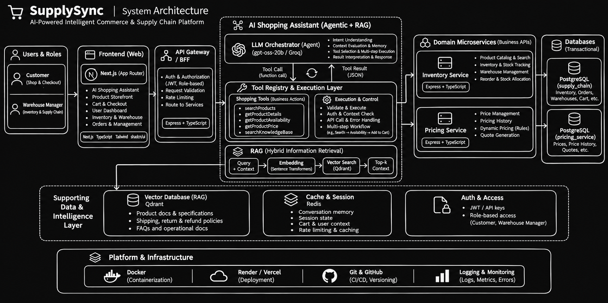
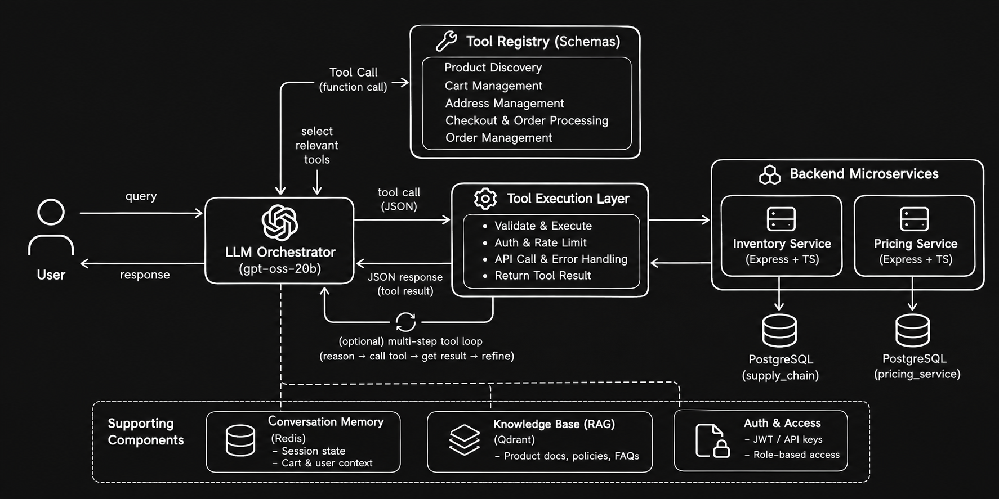
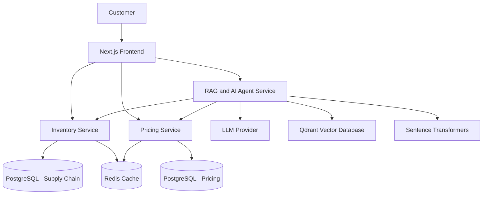

# SupplySync — AI-Powered Intelligent Commerce & Supply Chain Platform

**An AI-native e-commerce and supply-chain management platform powered by Agentic AI, Retrieval-Augmented Generation (RAG), and Microservices Architecture.**

## Live Demo

🚀 **Frontend:** https://supplysync-roan.vercel.app

Explore the deployed SupplySync application and experience the AI-powered shopping assistant.

[](https://nextjs.org/)
[](https://www.typescriptlang.org/)
[](https://www.python.org/)
[](https://fastapi.tiangolo.com/)
[](https://www.postgresql.org/)
[](https://redis.io/)
[](https://qdrant.tech/)

---

## Overview

SupplySync is an AI-powered commerce and supply-chain management platform designed to transform traditional e-commerce interactions into intelligent, conversational shopping experiences.

At its core is an **Agentic AI Shopping Assistant** that understands natural-language requests, identifies user intent, retrieves relevant information, invokes specialized backend tools, and executes multi-step shopping workflows.

Instead of navigating multiple pages and manually performing individual operations, customers can interact with the platform conversationally to discover products, compare prices, check inventory, manage their cart, and complete purchases.

The platform combines:

- **Agentic AI:** LLM-driven reasoning, tool selection, and multi-step execution.
- **Retrieval-Augmented Generation:** Context-aware responses grounded in a vector-based knowledge base.
- **Hybrid Information Retrieval:** Combines semantic document retrieval with structured, real-time database queries.
- **Microservices Architecture:** Independently structured services for inventory, pricing, and AI orchestration.
- **Transactional E-commerce:** Persistent carts, address management, quote-bound checkout, and order lifecycle management.
- **Supply Chain Management:** Inventory tracking, warehouse management, stock allocation, and reorder workflows.

The primary engineering objective is to build an AI assistant that does more than answer questions: it can interact with real application services and perform meaningful business operations.

## System Architecture

SupplySync follows a distributed microservices architecture
integrating Agentic AI, RAG, and transactional backend services.



### LLM Architecture

The AI shopping assistant uses an LLM-driven tool-calling
architecture with hybrid retrieval and backend integrations.



## Core Feature: Agentic AI Shopping Assistant

The AI assistant is the central component of SupplySync.

It acts as an intelligent interface between customers and the underlying commerce platform, translating natural-language instructions into structured operations through specialized tools.

Unlike a conventional chatbot that generates responses from an LLM alone, the assistant follows an **LLM + Tool Calling + RAG architecture**.

### 1. Agentic Architecture

The assistant receives a user's natural-language query, interprets the intent, determines the required information, and selects the appropriate tools.

Its execution flow is designed around:

1. **Intent Understanding:** Interprets user requests and identifies relevant entities, constraints, and required actions.
2. **Context Evaluation:** Uses conversation context and persistent memory to understand follow-up instructions.
3. **Tool Selection:** Determines which backend tools are necessary to fulfill the request.
4. **Tool Execution:** Invokes the required tools and retrieves structured results.
5. **Result Interpretation:** Processes tool responses and determines whether additional operations are necessary.
6. **Response Generation:** Produces a contextual response grounded in retrieved data and executed operations.

The agent supports multi-step workflows in which multiple tools may be required to complete a single user request.

### 2. Specialized Tool Calling

The assistant uses specialized tools to interact with the commerce platform.

| Tool                     | Responsibility                                                        |
| ------------------------ | --------------------------------------------------------------------- |
| `searchProducts`         | Search the product catalog using relevant search criteria.            |
| `getProductDetails`      | Retrieve detailed product information.                                |
| `getProductAvailability` | Check product stock and availability.                                 |
| `getProductPrice`        | Retrieve current product pricing.                                     |
| `searchKnowledgeBase`    | Retrieve relevant contextual information from the RAG knowledge base. |

These tools allow the LLM to access authoritative application data instead of relying on potentially outdated information stored in its training data.

The agent can combine multiple tools to satisfy complex requests.

**Example:**

User request:

"Find me a smartphone under ₹25,000 with at least 8GB RAM, check its availability, and add the best option to my cart."

The assistant can:

1. Extract product category, budget, and RAM constraints.
2. Search the product catalog.
3. Retrieve relevant product details.
4. Check availability.
5. Identify the best matching option.
6. Execute the cart operation through the shopping workflow.
7. Present the result to the customer.

The assistant also handles follow-up instructions using conversational context rather than treating every message as an independent request.

### 3. Hybrid RAG Architecture

SupplySync implements a hybrid Retrieval-Augmented Generation architecture that combines semantic retrieval with structured database access.

This distinction is important because product information and business policies require different retrieval strategies.

**A. Vector-based retrieval**

Used for unstructured information such as:

- Product documentation and specifications.
- Shipping and delivery policies.
- Return and refund policies.
- Frequently asked questions.
- Operational and company documentation.

Technology:

- Qdrant — Vector database.
- Sentence Transformers — Text embedding generation.
- LangChain Text Splitters — Document preprocessing and chunking.
- RecursiveCharacterTextSplitter — Context-preserving document segmentation.

Document processing pipeline:

1. Load and preprocess documents.
2. Split documents into chunks using a chunk size of 600 characters and an overlap of 100 characters.
3. Generate vector embeddings using Sentence Transformers.
4. Store embeddings and associated metadata in Qdrant.
5. Retrieve semantically relevant chunks when the assistant receives a query.
6. Pass retrieved context to the LLM for grounded response generation.

The embedding model produces **384-dimensional vectors**.

**B. Structured database retrieval**

Live commerce information is retrieved through backend services rather than relying on vector similarity.

Examples include:

- Product catalog information.
- Current product prices.
- Inventory availability.
- Warehouse stock.
- Cart contents.
- Customer orders.

The assistant accesses this information through specialized tools connected to the application services.

**Why hybrid RAG?**

Vector databases are effective for semantic retrieval, but they are not authoritative sources for frequently changing transactional information.

SupplySync therefore uses:

- Qdrant for semantic retrieval of unstructured knowledge.
- PostgreSQL for structured and transactional information.
- Backend tools for real-time business operations.
- The LLM for reasoning and contextual response generation.

This separation improves factual grounding and prevents the assistant from treating stale conversational or vector context as current inventory or pricing information.

### 4. Multi-Step Shopping Workflows

The assistant is integrated with actual commerce operations rather than functioning as an isolated conversational interface.

Supported workflows include:

**Product Discovery**

- Natural-language product search.
- Product filtering and discovery.
- Product detail retrieval.
- Price and stock verification.

**Cart Management**

- Add products to cart.
- Retrieve and update cart contents.
- Persistent cart management.
- Context-aware shopping interactions.

**Checkout and Orders**

- Address management and autofill.
- Checkout quote generation.
- Quote-bound checkout confirmation.
- Idempotent order creation.
- Order history and retrieval.
- Order cancellation.

The checkout workflow uses server-generated quotes and idempotency keys to help prevent stale-price purchases and duplicate order creation.

### 5. Conversational Memory and Assistant Optimization

The assistant incorporates persistent conversation context to support multi-turn interactions.

Key capabilities include:

- Maintaining relevant conversation context.
- Understanding follow-up instructions.
- Reusing previously established shopping preferences and product references.
- Optimizing the context sent to the LLM.
- Reducing unnecessary tool executions.
- Limiting retrieval results to relevant information.
- Managing token consumption under provider rate limits.

Additional optimizations include:

- Retrieval Top-K reduction to 3.
- Limiting product search results to the top 3 relevant results.
- Optimized tool execution and response handling.
- Assistant-level rate limiting.
- Structured interactions for shopping and checkout operations.

The objective is to reduce unnecessary LLM calls, improve response efficiency, and make complex shopping workflows more reliable.

### 6. Structured Conversational UI

The assistant is integrated into the frontend as a dedicated shopping interface.

Instead of returning only plain text, the experience supports structured interactions such as:

- Product displays within conversations.
- Product selection.
- Shopping actions.
- Interactive checkout forms.
- Address autofill.
- Cart integration.
- Contextual action flows.

This creates a conversational commerce experience where the user can discover products and complete transactions without constantly switching between application pages.

---

## System Architecture

SupplySync follows a distributed microservices architecture with independent application services communicating through API boundaries.



### Service Responsibilities

| Component           | Responsibility                                                 | Technology                  |
| ------------------- | -------------------------------------------------------------- | --------------------------- |
| Frontend            | Storefront, assistant UI, customer interactions, dashboard     | Next.js, React, TypeScript  |
| Inventory Service   | Product catalog, inventory, warehouses, cart, checkout, orders | Express, TypeScript, Prisma |
| Pricing Service     | Product pricing and price history                              | Express, TypeScript, Prisma |
| RAG Service         | AI agent, retrieval, embeddings, tool orchestration            | Python, FastAPI             |
| Vector Database     | Semantic document retrieval                                    | Qdrant                      |
| Relational Database | Structured and transactional application data                  | PostgreSQL                  |
| Cache               | Frequently accessed data and caching workflows                 | Redis                       |

Each service maintains its own responsibilities and database boundaries, reducing coupling and allowing individual components to evolve independently.

---

## Additional Platform Features

### 1. Inventory and Warehouse Management

- Product catalog management.
- Warehouse-level inventory tracking.
- Product availability checks.
- Stock reorder management.
- Order allocation.
- Inventory shortage and backorder handling.
- Category and SKU-based product organization.

### 2. Pricing Management

- Centralized pricing service.
- Manual product price management.
- Price history tracking.
- Dedicated pricing database.
- Separation of pricing responsibilities from inventory operations.

### 3. Customer Commerce

- Product storefront.
- Product search and filtering.
- Pagination.
- Product quick-view.
- Persistent shopping cart.
- Address management.
- Checkout and order creation.
- Order history and cancellation.

### 4. Manager Dashboard

- Authenticated manager interfaces.
- Inventory and warehouse management workflows.
- Product and pricing management.
- Operational visibility.

---

## Technology Stack

### Frontend

- Next.js (App Router)
- React
- TypeScript
- Tailwind CSS
- shadcn/ui

### Backend

- Node.js
- Express.js
- TypeScript
- Python
- FastAPI

### AI

- Large Language Models (LLMs)
- Agentic AI
- Function Calling / Tool Calling
- Retrieval-Augmented Generation (RAG)
- Sentence Transformers
- Vector Embeddings
- LangChain Text Splitters
- Groq LLM API

### Databases and Infrastructure

- PostgreSQL
- Prisma ORM
- Qdrant
- Redis
- Docker

### Development and Deployment

- Git and GitHub
- Postman
- Render
- Google Colab

---

## Engineering and Performance Considerations

SupplySync incorporates several engineering practices to improve reliability and scalability.

**Database Optimization**

- Server-side pagination.
- Selective field retrieval.
- Database indexing.
- Optimized Prisma queries.
- Reduced unnecessary data loading.

**Caching**

- Redis-based caching.
- Cache-aware data access.
- Reduced repeated database operations.

**API and Service Reliability**

- Dedicated service boundaries.
- Health-check endpoints.
- Request logging and duration tracking.
- Customer and manager authentication middleware.
- Rate limiting for assistant requests.

**Transactional Reliability**

- Persistent cart state.
- Server-generated checkout quotes.
- Quote-bound checkout confirmation.
- Idempotency keys for order creation.

**AI Performance**

- Context and token optimization.
- Reduced retrieval Top-K.
- Limited tool result sizes.
- Optimized tool execution.
- Persistent conversational context.

These optimizations address practical challenges such as database connection pressure, excessive data retrieval, LLM token limits, and unnecessary backend requests.

---

## Project Structure

The project is organized around independently maintainable frontend and backend services.

```text
SupplySync/
│
├── frontend/
│   ├── app/
│   ├── components/
│   ├── services/
│   └── ...
│
├── inventory-service/
│   ├── src/
│   ├── prisma/
│   └── ...
│
├── pricing-service/
│   ├── src/
│   ├── prisma/
│   └── ...
│
├── rag-service/
│   ├── app/
│   ├── agents/
│   ├── tools/
│   ├── ingestion/
│   └── ...
│
└── README.md
```

---

## Getting Started

### Prerequisites

- Node.js
- Python 3.10+
- PostgreSQL
- Redis
- Qdrant instance
- Groq API key or configured LLM provider

### 1. Clone the Repository

```bash
git clone https://github.com/Shreyash-Bhor/Intelligent_Supply_Chain_Management.git
```

### 2. Configure Environment Variables

Each service requires its own environment configuration.

Typical configuration categories include:

**Frontend**

- Inventory service URL.
- Pricing service URL.
- RAG service URL.
- Application-specific public configuration.

**Inventory Service**

- PostgreSQL connection string.
- Redis connection configuration.
- Authentication secrets.
- Service configuration.

**Pricing Service**

- PostgreSQL connection string.
- Pricing service configuration.

**RAG Service**

- LLM provider API key.
- Qdrant URL and API key.
- Embedding model configuration.
- Inventory and pricing service URLs.
- Agent configuration.

Refer to the individual service environment examples for exact variable names and required values. Never commit API keys or secrets.

### 3. Set Up Backend Services

Install dependencies independently for the Node.js services and configure their respective databases.

Run Prisma migrations and generate the Prisma client using the commands defined in each service.

### 4. Start Redis and Qdrant

Configure Redis and Qdrant using local Docker containers or hosted instances.

Ensure the backend services can connect to both infrastructure components.

### 5. Start the RAG Service

Install Python dependencies using the service's dependency configuration and start the FastAPI application.

Ensure the LLM provider and Qdrant credentials are configured.

### 6. Start the Frontend

Install frontend dependencies, configure backend service URLs, and start the Next.js development server.

The application should now be able to communicate with the individual backend services.

---

## Future Improvements

- Advanced multi-agent orchestration for specialized commerce workflows.
- More sophisticated hybrid search combining dense and sparse retrieval.
- Streaming tool execution and real-time assistant responses.
- Advanced evaluation of RAG retrieval quality and LLM response accuracy.
- Event-driven communication between microservices.
- Distributed tracing and centralized observability.
- Advanced demand forecasting integration into inventory replenishment.
- Automated inventory optimization and intelligent reorder recommendations.

---

## Key Engineering Highlights

| Area                    | Implementation                                  |
| ----------------------- | ----------------------------------------------- |
| AI Architecture         | Agentic LLM with specialized tool calling       |
| Knowledge Retrieval     | Hybrid RAG with Qdrant and PostgreSQL           |
| Embeddings              | 384-dimensional Sentence Transformer embeddings |
| Agent Workflows         | Multi-step shopping and transactional execution |
| Conversational Context  | Persistent conversation memory                  |
| Backend Architecture    | Independently structured microservices          |
| Database Layer          | PostgreSQL with Prisma ORM                      |
| Performance             | Redis caching, pagination, query optimization   |
| Transaction Reliability | Quote-bound checkout and idempotency            |
| Security                | Authentication middleware and rate limiting     |

---

## Project Objective

SupplySync explores how Agentic AI can be integrated into real-world commerce and supply-chain systems.

The primary focus is not simply building an LLM-powered chatbot, but engineering an intelligent system capable of understanding user intent, retrieving grounded information, coordinating distributed backend services, and executing real business workflows.

**The goal is to bridge the gap between conversational AI and transactional software systems.**

---

**Built with Next.js, TypeScript, Python, FastAPI, PostgreSQL, Qdrant, Redis, and Agentic AI.**
